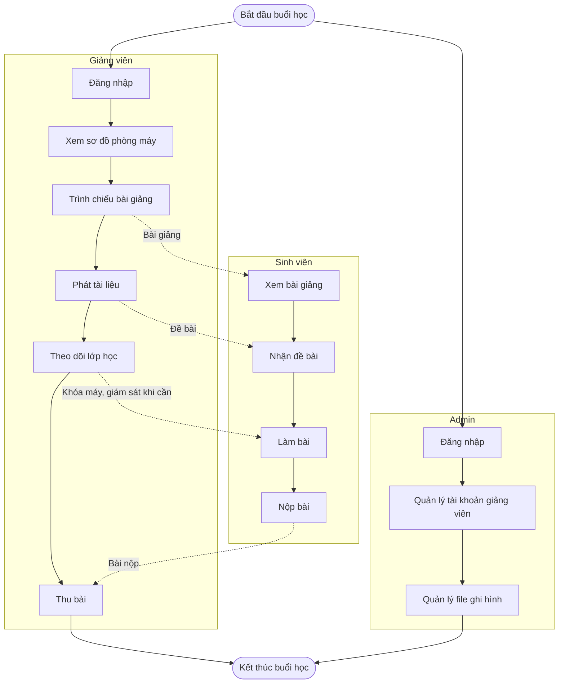

# Workflow tổng thể

Mô tả cách hệ thống được sử dụng trong một buổi học thực tế. Ba tác nhân: Admin, Giảng viên, Sinh viên.

## Ghi chú

- Trong bước "Theo dõi lớp học", giảng viên có thể khóa máy, mở khóa hoặc giám sát sinh viên. Đây là các thao tác tùy chọn, không tách thành nhánh riêng để sơ đồ tổng thể gọn.
- Admin làm việc độc lập với tiến trình buổi học, không điều khiển lớp.
- File ghi hình do giảng viên tạo ra được Admin quản lý ở nhánh riêng.