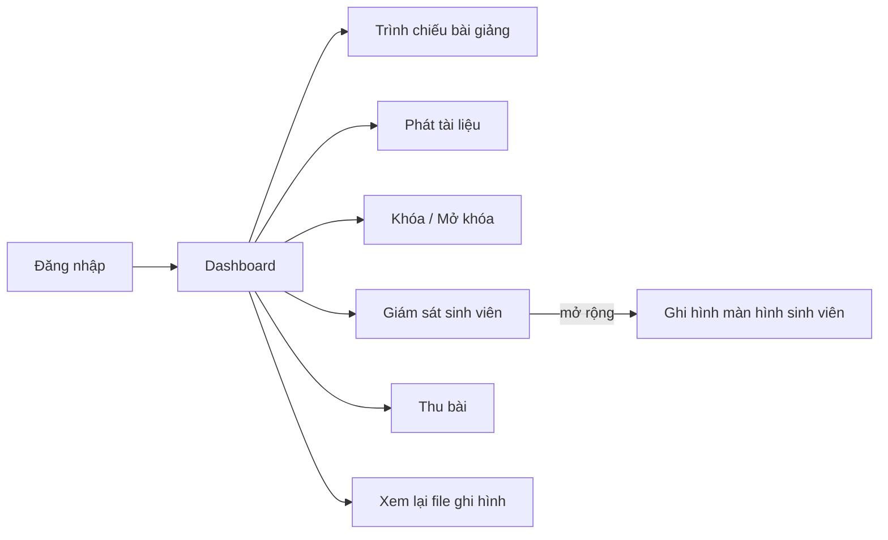

# Workflow2 — Workflow tổng thể và workflow con

## Nguyên tắc

| Nguyên tắc | Áp dụng |
|---|---|
| Dashboard là điểm vào duy nhất | Sau đăng nhập, người dùng đứng tại Dashboard; mọi chức năng đều bắt đầu từ đó |
| Các chức năng ngang hàng | Các chức năng nối trực tiếp từ Dashboard, không chức năng nào là bước của chức năng khác |
| Mỗi chức năng mở ra thao tác con | Workflow con chứa đủ các bước người dùng làm bên trong chức năng |
| Có bước chọn đối tượng | Chọn máy, chọn file trước khi thực hiện thao tác |
| Có đường quay lại | Kết thúc chức năng thì quay về Dashboard |
| Oval chỉ ghi "Bắt đầu" / "Kết thúc" | `(["Bắt đầu"])`, `(["Kết thúc"])` — không dùng câu khác |
| Hình bình hành cho nhập/xuất dữ liệu | Nhập liệu, chọn file/máy, hiển thị danh sách, thông báo kết quả — `[/"nội dung"/]` |
| Hình chữ nhật cho xử lý | Hành động hệ thống/người dùng thực hiện — `["..."]` |
| Hình thoi chỉ ghi "Kiểm tra" hoặc "Chọn thao tác" | Không ghi câu điều kiện dài |
| Không mô tả xử lý nội bộ | Không có giao thức, FPS, Mbps, icon cảnh báo, bước validate kỹ thuật |

## Danh sách file

| File | Nội dung | Mức chi tiết |
|---|---|---|
| `00-tong-the.md` | Dashboard, các chức năng ngang hàng, 3 tác nhân | Chỉ mức chức năng, không có bước chọn |
| `01-dang-nhap.md` | Đăng nhập | 5 bước |
| `02-quan-ly-tai-khoan.md` | Quản lý tài khoản giảng viên | 4 nhánh thao tác |
| `03-quan-ly-file-ghi-hinh.md` | Admin và Giảng viên | 2 sơ đồ riêng |
| `04-trinh-chieu-bai-giang.md` | Trình chiếu bài giảng | Có chọn máy |
| `05-phat-tai-lieu.md` | Phát tài liệu | Có chọn file, chọn máy |
| `06-giam-sat-sinh-vien.md` | Giám sát sinh viên | Có chọn máy |
| `07-ghi-hinh-man-hinh-sinh-vien.md` | Ghi hình | Nối tiếp từ giám sát |
| `08-khoa-mo-khoa-man-hinh.md` | Khóa / Mở khóa | Có chọn máy |
| `09-thu-bai.md` | Thu bài | Có chọn máy |

Mỗi file `.md` có ảnh `.png` cùng tên (riêng `03-...md` xuất thành `03a-...png` cho Admin và `03b-...png` cho Giảng viên).

## Sơ đồ quan hệ giữa các workflow

`Ghi hình` không phải chức năng ngang hàng trên Dashboard mà là workflow con của `Giám sát`, vì tài liệu quy định chỉ ghi được khi đang Live-view.

## Khác biệt so với bản cũ

| Bản cũ | Bản mới |
|---|---|
| Các chức năng nối tiếp nhau thành chuỗi | Các chức năng ngang hàng, tỏa ra từ Dashboard |
| "Xem sơ đồ phòng máy" như một màn hình riêng | Gộp thành Dashboard phòng máy |
| Thiếu bước chọn máy, chọn file | Bổ sung ở đầu mỗi workflow con |
| Không có đường quay lại | Mọi workflow quay về Dashboard, kết thúc bằng oval "Kết thúc" |
| Trạng thái giao diện (icon) nằm trong workflow | Đã bỏ, chuyển sang tài liệu đặc tả giao diện |