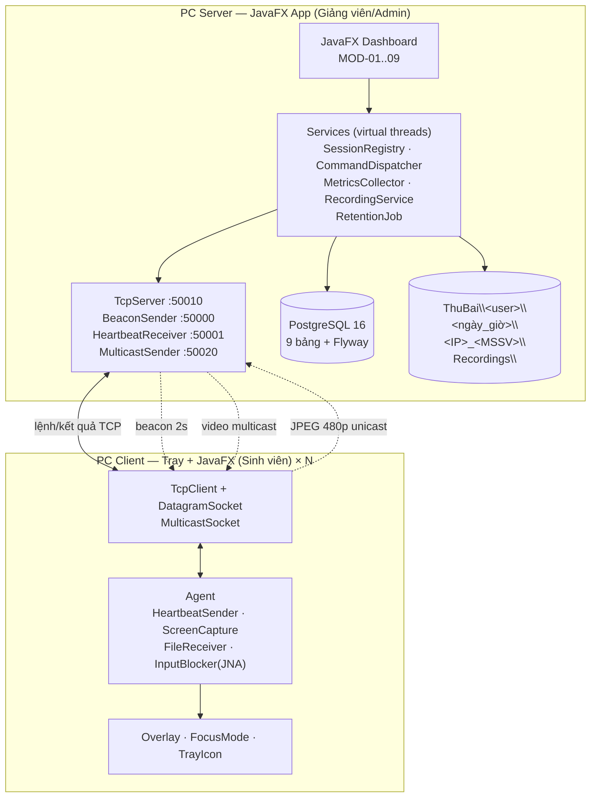
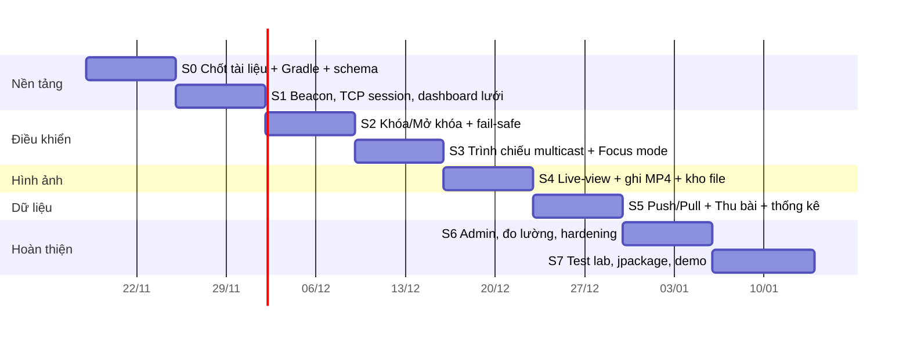

# KẾ HOẠCH TRIỂN KHAI — Hệ thống Quản lý & Giám sát Phòng máy

> Công nghệ chốt: **Java 21 + JavaFX + PostgreSQL 16**
> Thời gian: 18/11/2026 → 13/01/2027 (8 sprint)
> Tài liệu nguồn: `Docs/dac_tac_yeu_cau.md`, `Docs/phan_ra_chuc_nang.md`, `Chart/ERD/ERD.png`, `Chart/Workflow/`

---

## 1. Stack kỹ thuật

| Hạng mục | Lựa chọn | Lý do |
|---|---|---|
| JDK | **Java 21 LTS** (Temurin/Liberica Full hoặc Zulu FX) | Virtual threads cho mỗi kết nối TCP; JDK Full/FX có sẵn JavaFX |
| UI | **JavaFX 21 LTS** + FXML, MVVM nhẹ | Dashboard lưới, overlay toàn màn hình, binding realtime |
| Build | **Gradle 8 (Kotlin DSL) multi-module** + wrapper | Build 3 app, `jpackage` plugin |
| DB | **PostgreSQL 16/17** + **Flyway** + **HikariCP** + **JDBI 3** | Schema versioned; JDBI map record gọn cho dashboard đọc nhiều |
| Mạng | `ServerSocket/Socket` + `DatagramSocket` + `MulticastSocket` thuần JDK | Đúng TCP / UDP Unicast / UDP Multicast đã chốt |
| JSON | **Jackson** | Khung TCP `[4B len][2B type][1B ver][JSON]` |
| Chụp & nén | `java.awt.Robot` + `ImageIO` (JPEG q≈0.25) | 854×480 @5 FPS nằm trong khả năng Robot |
| Ghi MP4 | **JavaCV `FFmpegFrameRecorder`** (bytedeco) | FFmpeg native đi kèm, không cần cài exe ngoài |
| Chặn input / overlay | JavaFX `Stage` alwaysOnTop + **JNA** (`User32.BlockInput`) + **JNativeHook** | Chặn Alt+Tab, chuột, phím toàn cục |
| Hash mật khẩu | `PBKDF2WithHmacSHA256` (JDK) | Không cần thư viện ngoài |
| Log | SLF4J + Logback | |
| Test | JUnit 5 + **Zonky embedded-postgres** | Không phụ thuộc Docker |
| Đóng gói | `jpackage --type msi` (cần WiX 3.14) | Installer cho phòng lab |

**Lưu ý bắt buộc:** JavaFX app + hook bàn phím sẽ bị Windows Defender/AV để ý → phải whitelist hoặc ký số. `Ctrl+Alt+Del` và `Win+L` **không chặn được** từ user-space; giới hạn này phải ghi vào NFR.

---

## 2. Kiến trúc



---

## 3. Cấu trúc Gradle

```
settings.gradle.kts        # include 3 module + tests
gradle/libs.versions.toml  # version catalog
modules/
  shared/      Java library — Protocol, MessageType, DTO (Jackson records), cổng, framing
  server/      application + JavaFX — services, dao, flyway, migration
  client/      application + JavaFX — agent, overlay, tray
  shared-test/ fixture: fake client/server cho integration test
db/migration/  V1__schema.sql, V2__seed.sql
docs/          protocol-spec.md, nfr.md, test-plan.md, adr/
```

**Quy tắc:** mọi enum/mã lệnh/DTO nằm **duy nhất** trong `modules/shared`; `server`/`client` không tự khai báo lại.

---

## 4. Hợp đồng giao thức (chốt ở Sprint 0)

- Khung TCP: `[4B length][2B type][1B version][JSON payload]` — đọc bằng `DataInputStream.readInt()` + `readFully`.
- Khung UDP video: `[2B frameId][2B index][2B count][JPEG bytes]` — thiếu gói thì bỏ cả frame, không NAK.

| Nhóm | Mã | Chiều | Ghi chú |
|---|---|---|---|
| Discovery | `BEACON` | S→255.255.255.255 | IP, cổng TCP, version; 2 s/lần |
| Session | `HELLO` / `HELLO_ACK` | C↔S | GUID, hostname, IP, seat |
| Session | `LOGIN` / `LOGIN_ACK` | C↔S | MSSV + nonce + PBKDF2; trả token |
| Health | `HEARTBEAT` / `ACK` | C↔S | 10 s, mang RTT lần trước |
| Control | `LOCK` / `UNLOCK` | S→C | ds máy, thông báo ≤255, `commandId` chống trùng |
| Control | `PROJ_START` / `PROJ_STOP` | S→C | kèm group:port multicast |
| Control | `MON_START` / `MON_STOP` / `REC_START` / `REC_STOP` | S↔C | 1 máy/lần |
| File | `FILE_BEGIN` / `FILE_CHUNK` / `FILE_END` | 2 chiều | dùng chung push/pull |
| Collect | `COLLECT_START` | S→C | Client khóa `NopBai` rồi gửi |
| Report | `METRIC` / `LOSS_REPORT` / `RESULT` | C→S / S→C | %/Mbps/ETA/FPS/loss |

Kèm trong spec: state machine `Disconnected → Hello → LoggedIn → Busy`, timeout từng bước, và **fail-safe** (mất 3 ACK → Client tự unlock + thoát Focus + dừng stream).

---

## 5. Lộ trình 8 sprint



| Sprint | Thời gian | Mục tiêu | Sản phẩm Java cụ thể | DoD đo được |
|---|---|---|---|---|
| **S0** | 18–24/11 | Chốt baseline, dựng khung | `protocol-spec.md`, `nfr.md`, `V1__schema.sql` (Postgres), Gradle 3 module, spike 4 rủi ro | Build xanh + `./gradlew test` xanh; spike Robot 5 FPS, Multicast qua switch, JNA overlay, jpackage MSI đều có kết luận |
| **S1** | 25/11–01/12 | Kết nối, phiên, lưới, đăng nhập | `BeaconSender`, `TcpServer` (virtual thread/conn), `SessionRegistry`, `HeartbeatReceiver`, `LoginService`, `GridDashboardView` | 2 PC: tự kết nối <3 s; rút mạng → ô Đỏ sau ~30 s; sai mật khẩu bị từ chối; dashboard đúng vai trò |
| **S2** | 02–08/12 | Khóa/mở khóa | `LockCommandHandler`, `OverlayStage`, `InputBlocker`, `CommandIdCache`, `LockProgressView` | Khóa 5 máy <1 s; lệnh lặp không khóa 2 lần; máy vào muộn vẫn bị khóa; tắt Server → nhả khóa ≤30 s |
| **S3** | 09–15/12 | Trình chiếu | `MulticastSender`, `FocusMode`, `LossReporter`, `ProjectionView` | 1 luồng tới N máy; Alt+Tab bị chặn; đo FPS/Mbps/loss thực và ghi số vào ADR |
| **S4** | 16–22/12 | Live-view + ghi hình | `ScreenCaptureAgent`, `MjpegPacketizer`, `RecordingService` (JavaCV), `RecordingListDao`, `RetentionJob` | Ghi 5 phút → mp4 phát lại được; `recording_file` + `recording_log` đúng; job xóa theo `expires_at`; giảng viên chỉ thấy file mình |
| **S5** | 23–29/12 | Push/Pull | `FileSender`, `FileReceiver`, `SubmissionService`, `SubmissionStatsView` | File 200 MB tới đúng `<MSSV>\DeBai`; cây `ThuBai\...\` đúng; %/Mbps/ETA cập nhật; đứt kết nối → `submitting` |
| **S6** | 30/12–05/01 | Admin, đo lường, hardening | `AccountService`, `MetricsCollector`, `MetricsView`, logging + retry | CRUD tài khoản 4 thao tác + xóa mềm; retention 1–120; mất mạng luân phiên không crash |
| **S7** | 06–13/01 | Test lab, đóng gói | `jpackage` MSI, `test-plan.md` thực thi, demo script | 10 checklist nghiệm thu xanh; cài trên máy sạch chạy được; demo 10 phút không lỗi |

---

## 6. Phân công

| Người | S0–S2 | S3–S5 | S6–S7 |
|---|---|---|---|
| Võ Minh Hiếu | `shared` protocol, TCP session, heartbeat | Live-view + ghi hình | Tích hợp, demo |
| Chung Cơ Tuấn | Flyway schema, DAO, seed | Thu bài + thư mục | Hardening, jpackage |
| Đỗ Nguyễn Hoàng Tuấn | `GridDashboardView`, binding | Đo lường, biểu đồ | Test hiệu năng |
| Âu Thị Huyền Trang | Test plan, test case | Test push/pull | Test lab, tài liệu |
| Phạm Thị Thuỳ Trang | UI khóa/trình chiếu | UI admin + kho file | Tài liệu, demo script |

---

## 7. Vòng đời một module (áp dụng cho cả 9 module)

1. Thêm message + DTO vào `shared`, unit test framing/parse.
2. Viết service Server + **fake client** (console `main`) để test trước khi có UI.
3. Viết agent Client + test fail-safe.
4. Nối JavaFX view, hiển thị đúng dữ liệu Output mà module tạo ra.
5. Chạy test case tương ứng trong `test-plan.md`, cập nhật trạng thái.

---

## 8. Rủi ro và giảm thiểu

| Rủi ro | Mức | Giảm thiểu |
|---|---|---|
| `Robot` chụp chậm / lệch FPS trên máy yếu | Cao | Spike S0 đo thật; nếu <5 FPS thì giảm còn 3–4 FPS và sửa BR-03 |
| Multicast bị switch chặn | Cao | Spike S3; dự phòng nhiều luồng unicast, ghi vào NFR |
| Hook bàn phím bị AV chặn | Trung | Whitelist máy lab hoặc ký số; ghi rõ giới hạn Ctrl+Alt+Del |
| JavaFX không có trong JDK | Trung | Bắt buộc JDK Full/FX trong README; kiểm tra `java --list-modules` có `javafx` |
| JNA/JNativeHook khác kiến trúc (32/64) | Thấp | Chỉ build x64, cố định trong Gradle toolchain |
| Bitrate vượt 0,5 Mbps (MJPEG) | Trung | Đo ở S3, hiệu chỉnh quality; nếu cần đổi BR-03 thành "0,5–1 Mbps" |
| Không có Docker cho test DB | Thấp | Dùng Zonky embedded-postgres |
| 5 người cùng sửa `shared` | Trung | Chốt danh sách message ở S0; PR vào `shared` cần Hiếu review |
| Mất dữ liệu khi Server sập giữa lúc thu bài | Trung | Ghi file tạm `.part` rồi rename; giữ `submission.status = 'submitting'` |

---

## 9. Việc làm ngay (3 ngày tới)

1. **`Docs/protocol-spec.md`** theo bảng mã lệnh mục 4 — artifact quyết định, mọi sprint bám vào.
2. **`Docs/nfr.md`**: tối đa 40 máy/phòng, phản hồi lệnh ≤1 s, 480p/5 FPS/0,5–1 Mbps, giới hạn bảo mật (không TLS, không chặn Ctrl+Alt+Del).
3. **Khung Gradle**: `gradle init` → 3 module + version catalog + `jpackage` task, commit `feat: scaffold java solution`.
4. **`db/migration/V1__schema.sql`** từ ERD (kiểu PostgreSQL) + `V2__seed.sql` (1 admin).
5. **Spike 1 ngày/ý**, ghi vào `docs/adr/`: (a) Robot 854×480 đạt bao nhiêu FPS, (b) Multicast qua switch lab, (c) JavaFX overlay + JNA BlockInput, (d) JavaCV ghi mp4 từ JPEG.

---

## 10. Truy vết tài liệu → sprint

| Tài liệu | Dùng ở sprint |
|---|---|
| `Docs/dac_tac_yeu_cau.md` (BR-01…BR-10) | S1–S7, mỗi sprint đối chiếu BR tương ứng |
| `Docs/phan_ra_chuc_nang.md` (7 phân hệ + giao thức) | S0 (spec), S1–S6 |
| `Chart/ERD/ERD.png` (9 bảng) | S0 `V1__schema.sql`, S4–S6 |
| `Chart/Workflow/` (11 sơ đồ) | S1–S6 (mỗi workflow con ứng với 1 module) |
| `Chart/BFD/BFD.drawio.png` | S0 rà soát phạm vi |
