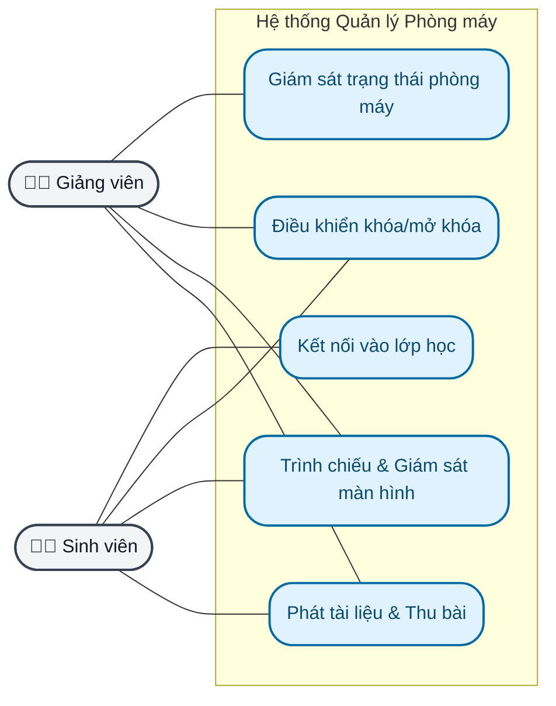
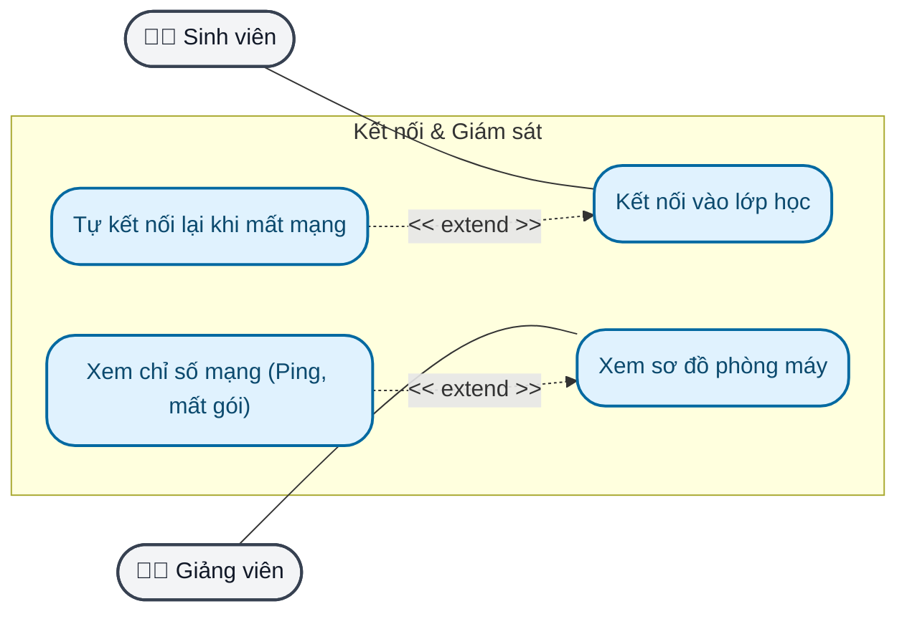
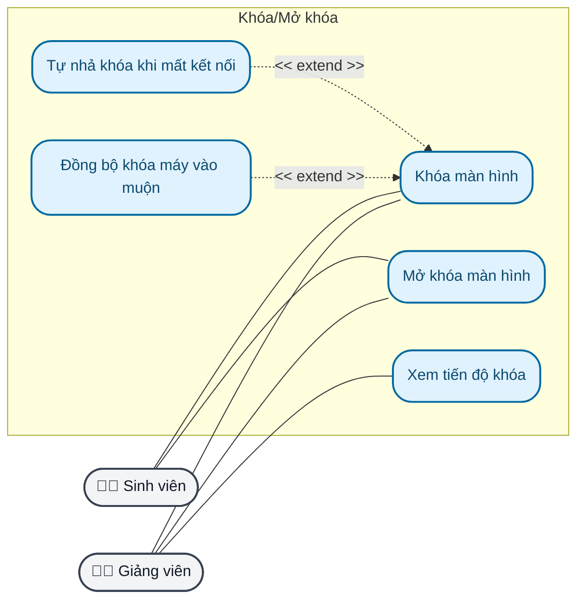
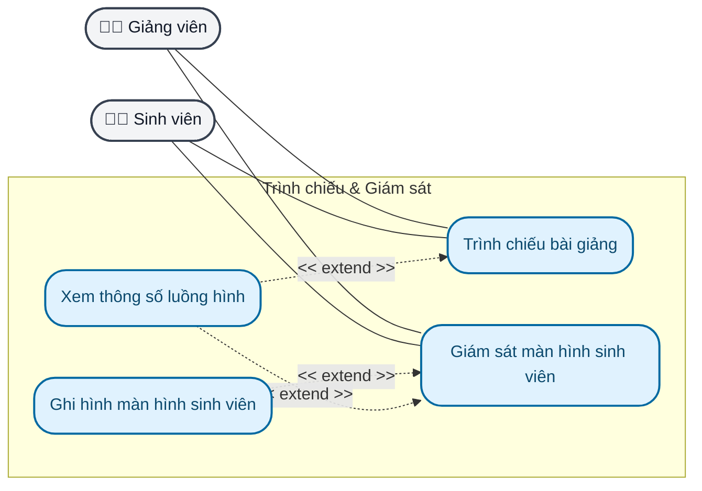
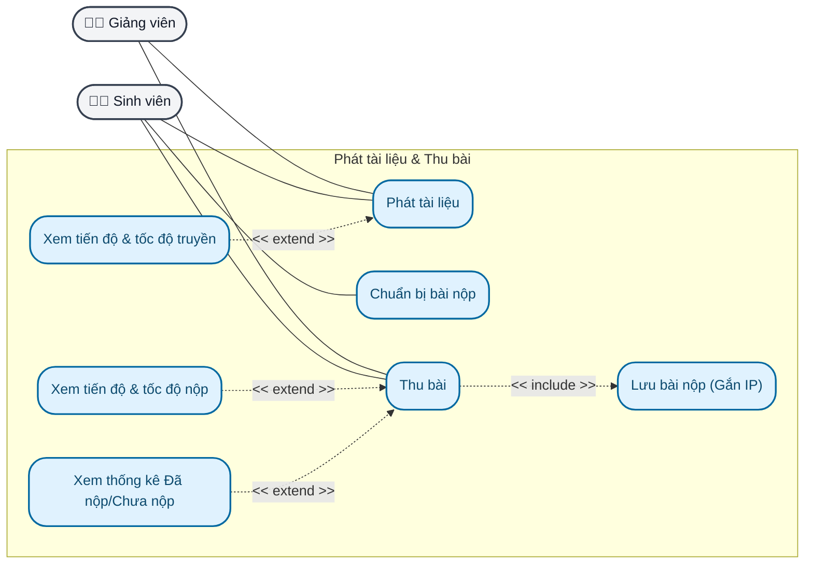

# TÀI LIỆU SƠ ĐỒ USE CASE (CHUẨN UML)
**Dự án:** Hệ thống Quản lý Phòng máy (Client-Server PC)

*Quy tắc áp dụng:* 
- Chỉ có 2 Actor ngoại vi (Con người: Giảng viên, Sinh viên). Không định nghĩa Hệ thống làm Actor.
- Quan hệ Actor - Use Case là Association (Đường thẳng liền, không mũi tên).
- Quan hệ `<<include>>` trỏ từ UC gốc sang UC thành phần. Quan hệ `<<extend>>` trỏ từ UC mở rộng về UC gốc.
- Không vẽ luồng dữ liệu, giao thức (TCP/UDP) hay các tính năng ngầm của hệ thống (nhịp tim, chunking file, ghép file) vào sơ đồ này.

---

## 1. SƠ ĐỒ USE CASE MỨC TỔNG QUÁT

---

## 2. CÁC SƠ ĐỒ USE CASE PHÂN RÃ

### Sơ đồ 1: Kết nối & Giám sát trạng thái

---

### Sơ đồ 2: Khóa/Mở khóa màn hình

---

### Sơ đồ 3: Trình chiếu & Giám sát màn hình

---

### Sơ đồ 4: Phát tài liệu & Thu bài

