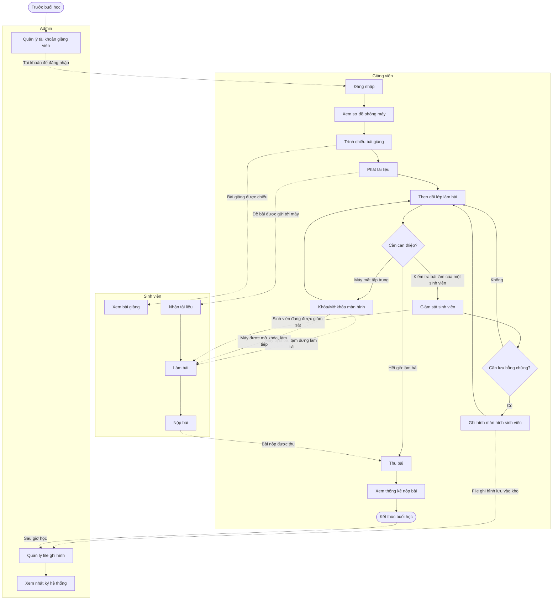
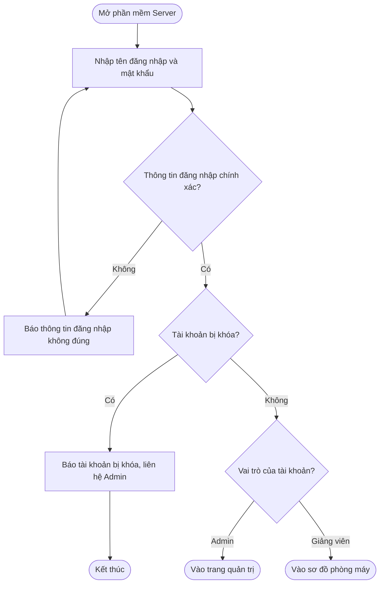
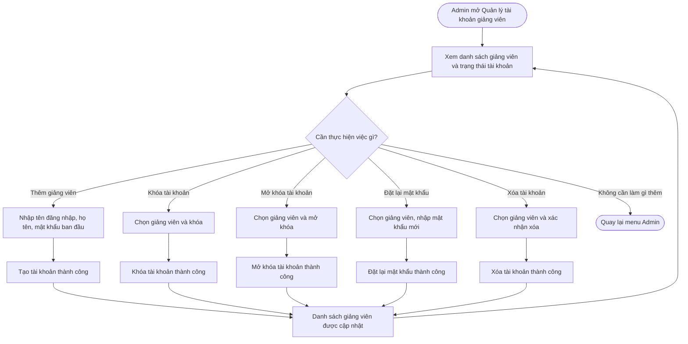
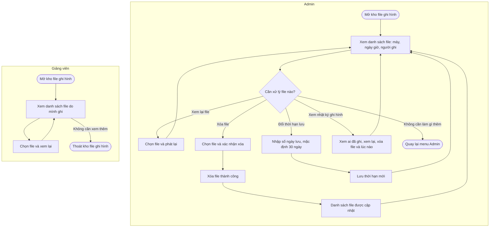
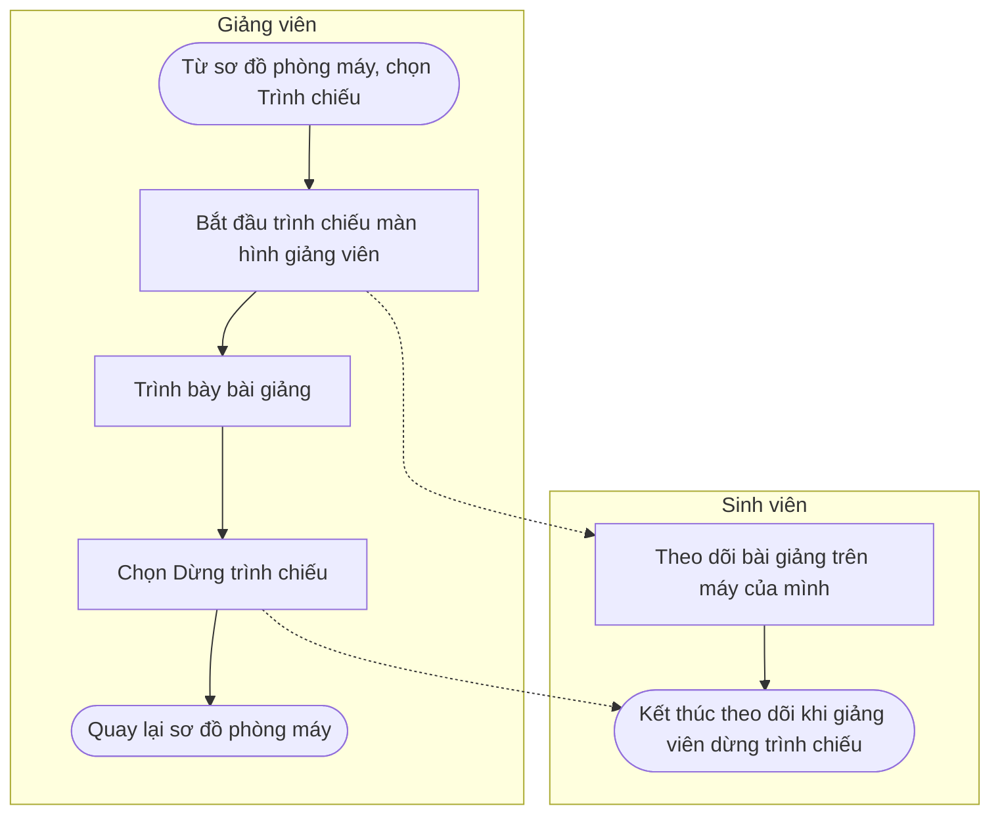
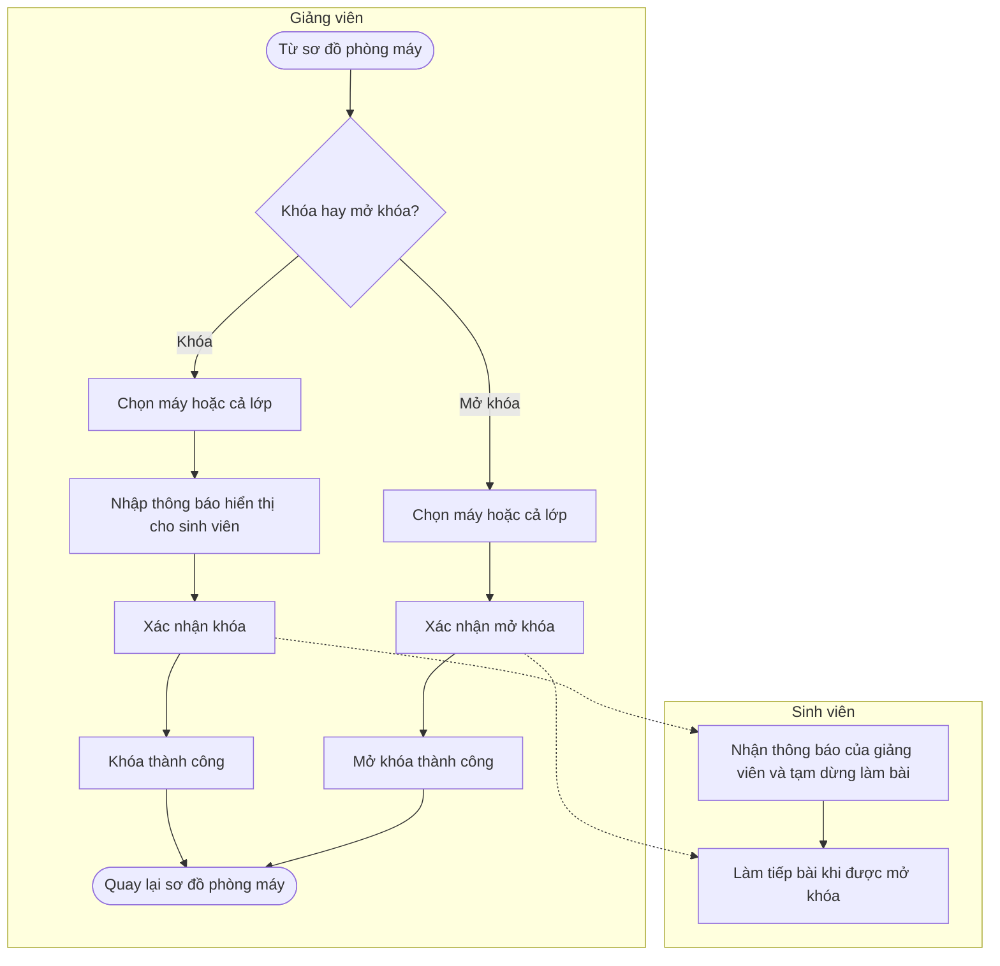
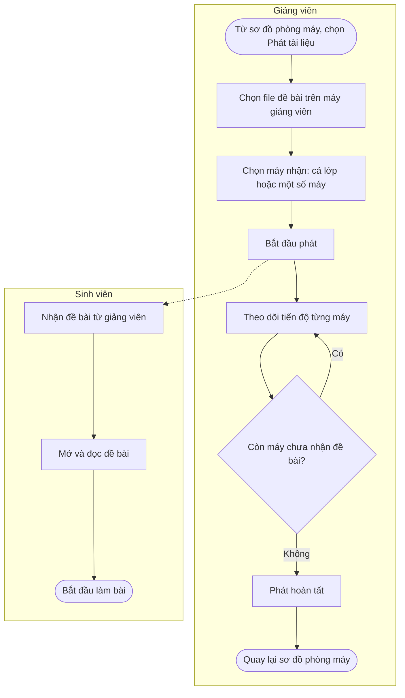
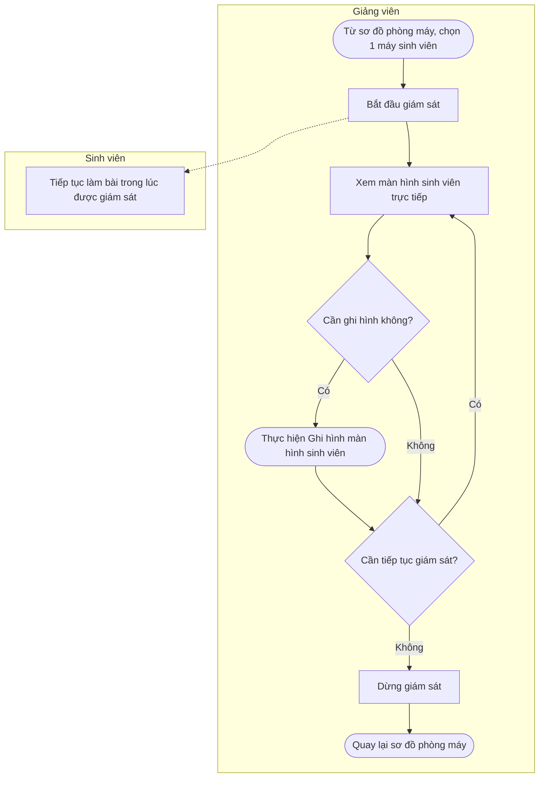
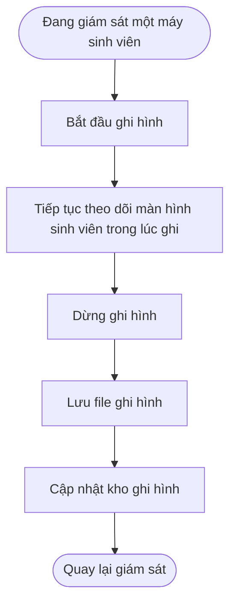
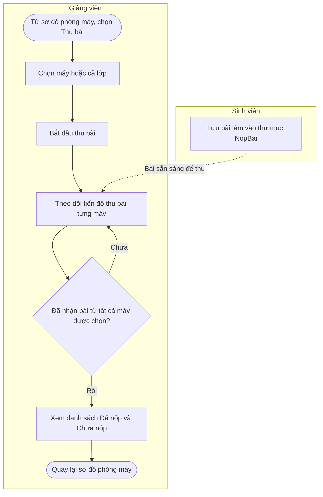

# WORKFLOW HỆ THỐNG QUẢN LÝ PHÒNG MÁY

**Dự án:** Hệ thống Quản lý & Giám sát Phòng máy (Client-Server)
**Tác nhân:** Admin, Giảng viên, Sinh viên

---

## 0. Workflow tổng thể

---

## 1. Đăng nhập

---

## 2. Quản lý tài khoản giảng viên

---

## 3. Quản lý file ghi hình

---

## 4. Trình chiếu bài giảng

---

## 5. Khóa/Mở khóa màn hình

---

## 6. Phát tài liệu

---

## 7. Giám sát sinh viên

---

## 8. Ghi hình màn hình sinh viên

---

## 9. Thu bài

